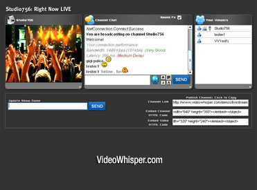

# PHP-Live-Streaming-Webcam

> **Legacy integration reference — November 2026.** This repository contains historical Flash/RTMP/Wowza-era integration code and setup notes. It has not received the security or browser validation of the current HTML5 demos. For browser broadcasting and playback, start with [the current solution](https://demo.videowhisper.com/vws-html5-livestreaming/). See [MIGRATION.md](MIGRATION.md). Preserve existing deployments for review; do not install this historical code as a new public demo.

[PHP Live Streaming Homepage](https://videowhisper.com/?p=php+live+streaming)

## Key Features
 * Create Live Video Channels
 * Broadcast Live Video from Browser
 * Share Channels Link
 * HTML Embed Code
 * Limit Total Use Time by Channel
 * Simple Setup
 * Tips ($) with Sound and Message
 * Easy to Install, Configure
 * Full PHP Source Code
 * Easy to Integrate
 * Transcoding Support for HTML5 playback
 * HLS iOS / MPEG DASH Android
 * WebRTC HTML5 broadcast/playback server support

[PHP Live Streaming Webcam Demo](https://videowhisper.com/demos/livestreaming/)

## Installation Instructions for PHP Live Video Streaming Software
 * Before installing, make sure your hosting environment meets all [requirements](https://videowhisper.com/?p=Requirements) (including a supported RTMP server). 
 * For enabling transcoding for HTML5 HLS / MPEG DASH playback required for iOS/Android delivery, special requirements apply: latest Wowza and FFMPEG with Flash and HTML5 specific codecs.
 * For cross-browser WebRTC broadcast/playback and RTMPS, a SSL certificate needs to be configured with Wowza SE and feature configured on streaming server.

 1. If you're not hosting RTMP with VideoWhisper (see requirements and turnkey hosting options) go to [RTMP Application Setup](https://videowhisper.com/?p=RTMP+Applications) for installation details
 2. Deploy files to your web installation location. (Example: yoursite.domain/php-live-streaming-webcam/)
 3. Fill your RTMP path into settings.php
Give writable directories to the PHP account with the minimum required permissions. Do not use world-writable permissions. Review private/public storage and server access rules before deploying.
 5. To enable transcoding for HTML5 playback, configure HLS / MPEG DASH as per Wowza specs and fill httpstreamer & httpdash setting in settings.php . 
If you have Wowza hosting with us, our staff can assist with setting this up (our plans come with a rtmp address preconfigured for such usage).

This is a simple setup for easy deployment and integration with other PHP scripts. 
For a quick setup, see [VideoWhisper Turnkey Stream Hosting Plans](https://videowhisper.com/?p=Wowza+Media+Server+Hosting#plans) that include requirements for all features and installation.

For assistance and clarifications, [Contact VideoWhisper](https://consult.videowhisper.com/).

For a more advanced setup, see this turnkey live video broadcasting site solution based on WP: 
[Broadcast Live Video](https://broadcastlivevideo.com/) 

